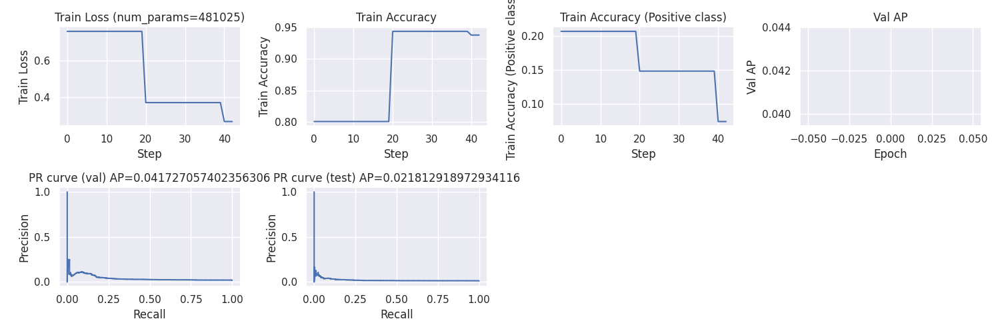

# Predicting Bug-Introducing Commits with Deep Learning

**Course:** Data C182, Designing, Visualizing and Understanding Deep Neural Networks (UC Berkeley, Fall 2024), final project

**Question:** Can a neural network flag which code commits are likely to introduce bugs, from commit metadata alone?

## Data
Commit histories from open-source repositories (for example OpenSSL): the number of files changed, lines added and deleted, author and committer, commit time and file types. Each commit is labeled faulty or clean. The data is **highly imbalanced: only about 1.4% of commits are faulty.** After encoding, the training set has **43,505 commits and 1,098 features**.

## What I did
I built on the course's starter code and wrote the parts below.
- **Data pipeline:** built the preprocessing step (scaling numeric features, encoding categorical ones such as author and file extension) and a custom PyTorch `Dataset` for the CSV data. Benchmarked the DataLoader at **15,515 rows per second**, about 3× the 5,000 required.
- **Training:** implemented the training loop for binary classification with `BCEWithLogitsLoss`.
- **Evaluation:** wrote prediction and metric code to compute precision-recall curves, **average precision (AP)**, and the operating point that maximizes F1. With this much imbalance, accuracy is misleading, so AP is the main metric.
- **Baselines and models:** compared trivial baselines, a single-layer network, and my own **deeper network** with 3 hidden layers, **batch normalization** and **dropout**.

## Results (test set)

| Model | Average precision |
|---|---|
| Random / always-positive baseline | 0.014 |
| Single-layer NN | 0.018 |
| **My improved deep NN** | **0.022** |

My model reached about **1.6× the AP of the random baseline** and 19% more than the single-layer network. Predicting faulty commits from metadata alone is hard, so the absolute AP stays low.

Training curves from earlier runs: [single-layer network](main_train_pt4.png) (test AP 0.018) and [first training run](main_train_pt2c.png).

## Skills and tools
PyTorch (custom Dataset/DataLoader, nn.Module, training loops), batch normalization, dropout, imbalanced classification, precision-recall analysis, average precision, scikit-learn (ColumnTransformer, OneHotEncoder, StandardScaler), unit tests, Matplotlib.
